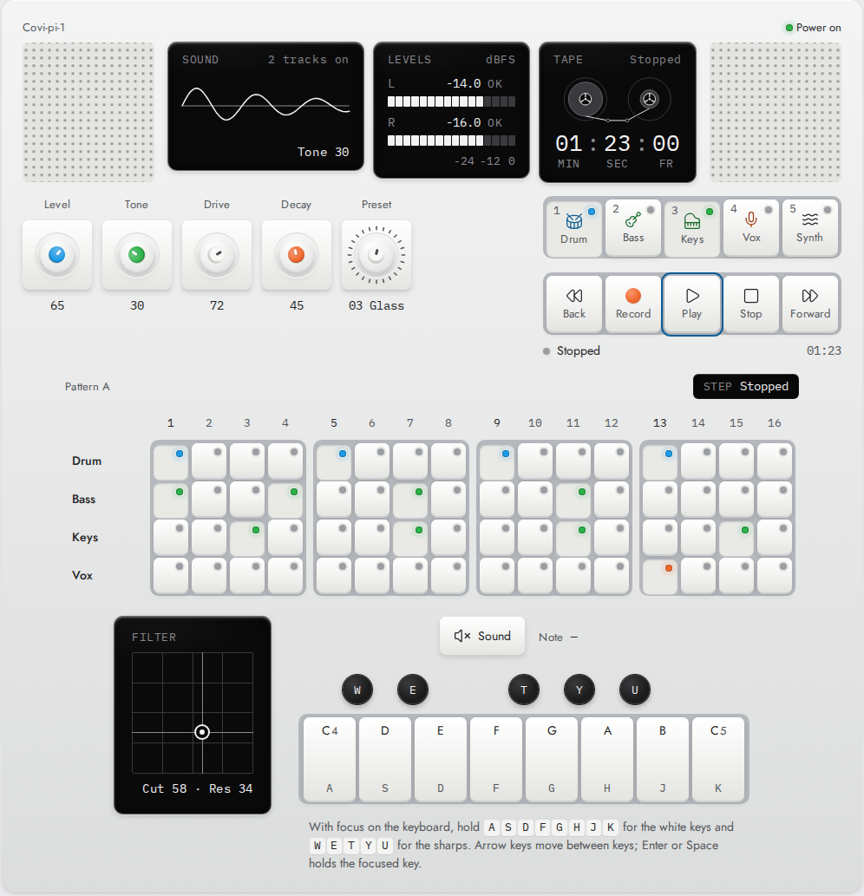

# Covi-pi-1 Design

**A tactile, hardware-inspired design system for the web.**

[**Project page**](https://coviyarce.github.io/covi-pi-1/) · [**Live Storybook**](https://op1.covilabs.com) · [**Request access**](https://coviyarce.github.io/covi-pi-1/#access)

<picture>
  <source media="(prefers-color-scheme: dark)" srcset="img/device-dark.png">
  
</picture>

This repository holds only the public project page for Covi-pi-1 Design, served by GitHub Pages at <https://coviyarce.github.io/covi-pi-1/>. The design system's source is in a private repository; access is granted only under the [Attribution Agreement](ATTRIBUTION_AGREEMENT.md): accept it, write your own attribution promise and sign on the [request form](https://coviyarce.github.io/covi-pi-1/#access).

The page is plain HTML styled with Covi-pi-1's own built CSS (`css/`, from v3.0.0). To update it, rebuild the design system (`npm run build:lib`) and copy `dist/tokens.css`, `base.css`, `fonts.css`, `fonts/` and the component stylesheets the page uses.

## Licence

Covi-pi-1 Design and this page are © 2026 Luis Carlos Covilla Yarce, licensed under [Creative Commons Attribution 4.0 International](LICENSE). The bundled fonts (Jost and IBM Plex Mono) are under the SIL Open Font License 1.1.
